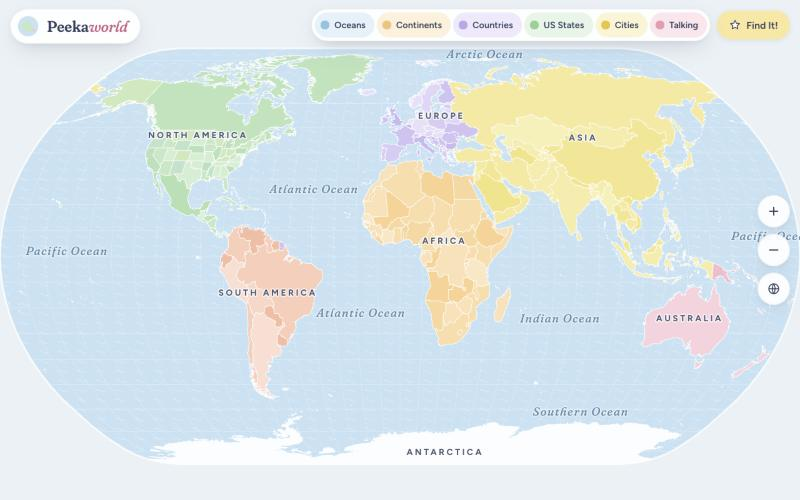
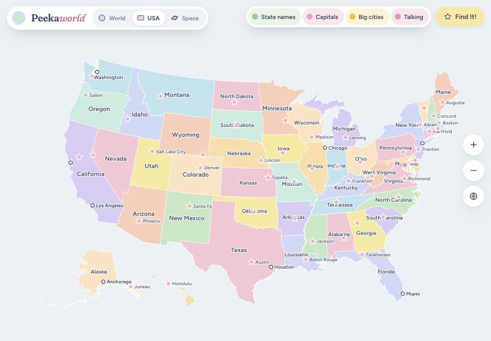
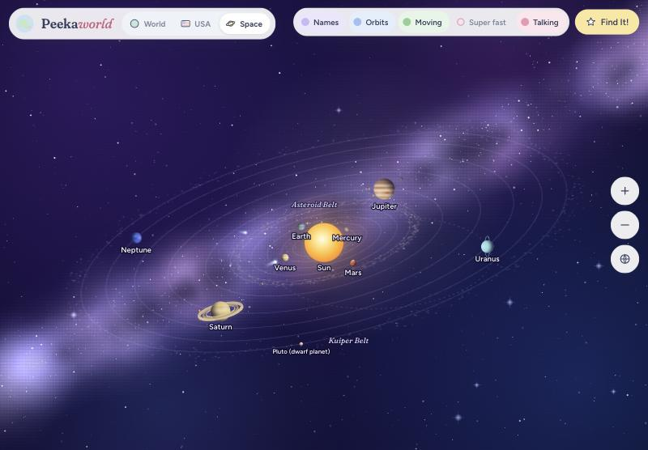
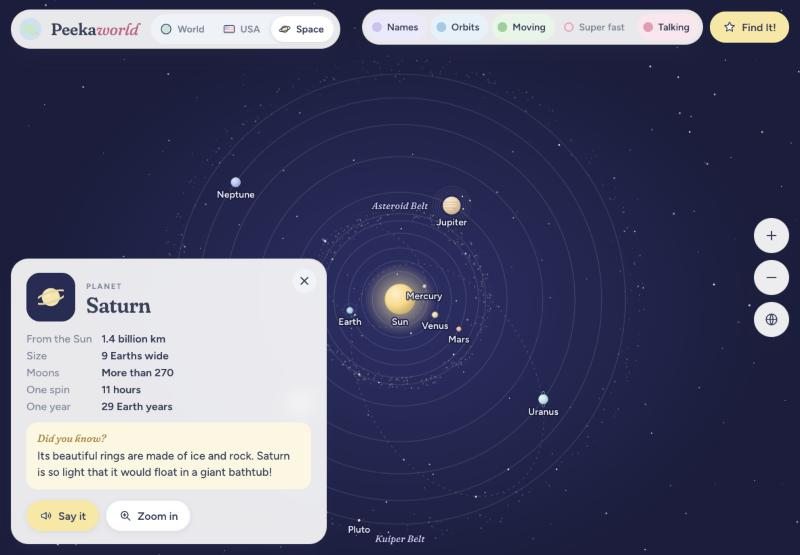

# 🌍 Peekaworld

**Peek into every corner of the planet!**

Peekaworld is a soft, pastel, talking map made for curious kids. Three maps in
one: the whole **World**, the **USA** state by state, and **Space** with the
planets circling the Sun. Pinch, zoom and tap your way around. Every place has
its own fun fact waiting to be found.



| 🇺🇸 USA | 🪐 Space |
|---|---|
|  |  |

---

## ✨ What's inside

### 🌍 World

| | |
|---|---|
| 🌊 **Oceans & seas** | All five oceans, plus the Mediterranean, the Caribbean, the Caspian (secretly a lake!) and more. Tap the water itself. |
| 🗺️ **Continents** | Seven pastel continents. Turn colors off and every country gets its own rainbow shade. |
| 🏳️ **Countries & flags** | Every country wears its flag right next to its name on the map. Tap one for the big flag, continent, capital city and a "Did you know?" fact. Flip the **Flags** switch to hide them. |
| ⭐ **Cities** | About 100 cities. Capitals are pink stars, and more cities pop up the closer you zoom. |

### 🇺🇸 USA

| | |
|---|---|
| 🗺️ **States** | All 50 states plus Washington, D.C., painted so neighbors never share a color. Each has its capital, nickname and a fun fact. Alaska and Hawaii get their own spots at the bottom. |
| ⭐ **Capitals** | A pink star for every state capital. Tap one to learn about it. |
| 🏙️ **Big cities** | New York, Los Angeles, Chicago, New Orleans and more. |

### 🪐 Space

| | |
|---|---|
| 🌌 **Milky Way sky** | The solar system floats on a tilted plane in front of a glowing Milky Way, so planets pass in front of and behind the Sun. |
| ☀️ **The Sun** | Glowing in the middle of everything. |
| 🪐 **Eight planets** | In their real colors, from rusty Mars to striped Jupiter with its Great Red Spot. They really move! Each planet travels at its true speed compared to the others, so Mercury zips around while Neptune creeps. |
| 🌙 **Moons** | Earth's Moon, Jupiter's four big moons and Saturn's Titan. Zoom in close to see them circle. |
| 🪨 **Asteroids & dwarf planets** | The Asteroid Belt with Ceres and Vesta, plus Pluto (a dwarf planet) out in the icy Kuiper Belt. |
| ☄️ **Comets** | Halley's Comet and Comet Encke on their stretched-out orbits. Their tails grow as they swing close to the Sun. |
| ⏯️ **Moving / Super fast** | Pause the planets, or speed them up 12 times. |

Distances and sizes in Space are squished so everything fits on one screen.

### On every map

| | |
|---|---|
| 🔊 **Talking map** | Tap anything and Peekaworld says its name out loud. Press **Say it** to hear the fun fact too. |
| 🎯 **Find It! game** | "Can you find Brazil?" Tap the right spot and you get confetti and a star. |



## 🎮 How to play Find It!

1. Press **Find It!** in the top corner.
2. Pick a level. Each map has its own:
   - **World:** **Easy** (big countries and oceans) or **All countries**
   - **USA:** **States** ("Find Texas!") or **Capitals** ("Which state has the capital Austin?")
   - **Space:** find the Sun, the Moon, the planets, Pluto and Halley's Comet
3. Peekaworld asks you to find a place. Go hunting!
4. Every right answer earns a ⭐. Every 5 stars brings a big confetti party 🎉
5. Stuck? Press **Hint** and the answer will flash. Miss three times and it flashes on its own.

Your stars are saved on your device, so they're still there next time.

## 🖐️ Controls

| What you want | iPad / tablet | Laptop / mouse |
|---|---|---|
| Learn about a place | Tap it | Click it |
| Zoom into a place | Double-tap it | Double-click it |
| Zoom in or out | Pinch | Scroll wheel, or `+` / `-` keys |
| Move around | Drag with one finger | Click and drag |
| Go back to where you were | Yellow ← button | ← button, `Esc`, `Backspace`, or the mouse's back button |
| Switch maps | World / USA / Space tabs | World / USA / Space tabs |
| See the whole map again | 🌐 button | 🌐 button |
| Peek at a name | | Hover over it |

The buttons along the top turn things on and off. They change with each map:
Oceans, Continents, Countries and Cities on the World; State names, Capitals and
Big cities on the USA; Names, Orbits, Moving and Super fast in Space. Talking is
on every map.

You can link straight to a map: add `#world`, `#usa` or `#space` to the end of the address.

## 🚀 Run it yourself

Peekaworld is a single web page with no build step and nothing to install.
It loads the map data with `fetch`, so it needs a tiny local web server rather
than opening the file directly:

```bash
python3 -m http.server 5180
```

Then open <http://localhost:5180>.

### Put it on the internet with GitHub Pages

1. Go to **Settings → Pages** in this repo.
2. Under **Build and deployment**, choose **Deploy from a branch**, then `main` and `/ (root)`.
3. In a minute it will be live at `https://nehamo-dev.github.io/Peekaworld/`.
4. On an iPad, open that link in Safari and tap **Share → Add to Home Screen**.
   Peekaworld now opens full screen like a real app.

## 🧩 How it's built

```
index.html          the whole app: styles, map drawing, facts, game
data/countries.json world country shapes (TopoJSON)
data/states.json    US state shapes (TopoJSON), used by the USA map
flags/              a flag picture for every country
docs/               screenshots for this README
```

- **[D3](https://d3js.org)** draws the maps and handles zooming and panning. The World uses the Natural Earth projection and the USA uses Albers USA, which tucks Alaska and Hawaii in below the other states.
- The Space map is drawn by hand in SVG. Comets follow real elliptical orbits, worked out with Kepler's equation.
- **[TopoJSON](https://github.com/topojson/topojson-client)** turns the compact map files into shapes.
- Map shapes come from **[world-atlas](https://github.com/topojson/world-atlas)** and **[us-atlas](https://github.com/topojson/us-atlas)**, which are built from [Natural Earth](https://www.naturalearthdata.com) and the US Census Bureau.
- Flags come from **[flag-icons](https://github.com/lipis/flag-icons)** (MIT license).
- Fonts are **Fraunces** and **Figtree** from Google Fonts.
- The voice is the browser's built-in speech, so there's nothing to sign up for.

Facts, capitals and city lists live in plain lists near the top of the
`<script>` in `index.html`, so adding a new fun fact is a one-line change.

## 🌱 Ideas for what's next

- 🦒 Animals that live in each country
- 🗼 Famous landmarks on the map
- 👋 "How do you say hello?" in every country
- 🏔️ Rivers, mountains and deserts
- 🔍 A search box
- 🌌 Constellations and famous spacecraft
- 🏆 More game levels: flags, "which continent?"

---

Made with curiosity for little explorers. Happy peeking! 👀
